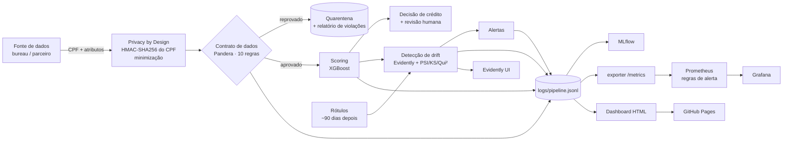
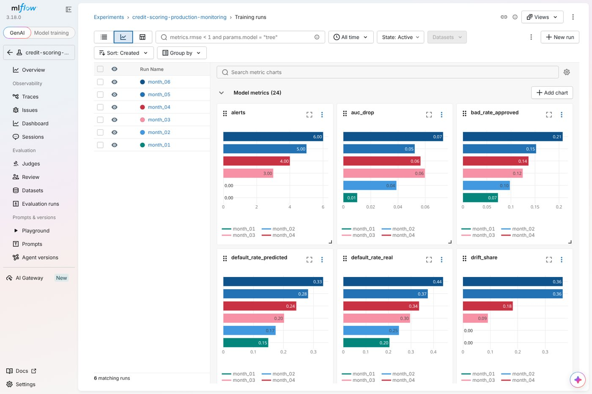
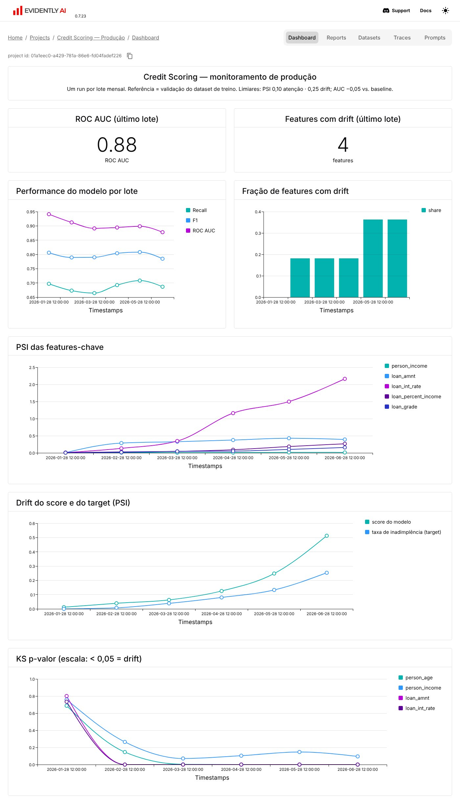
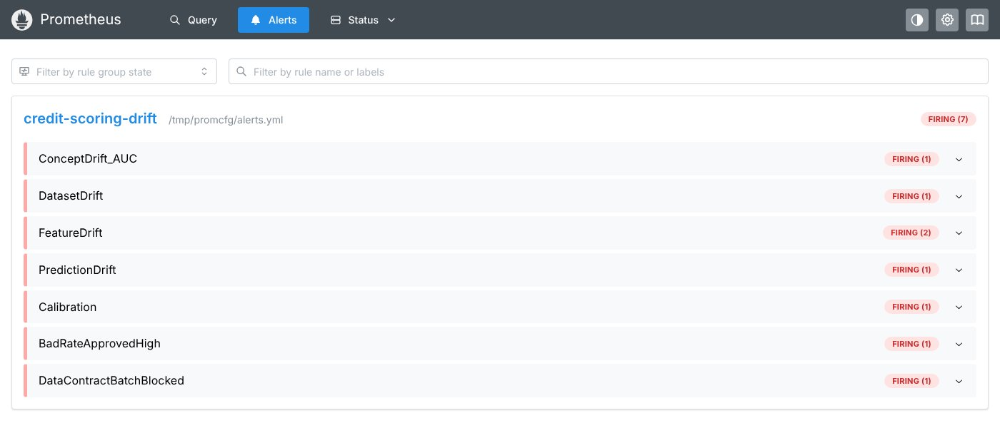
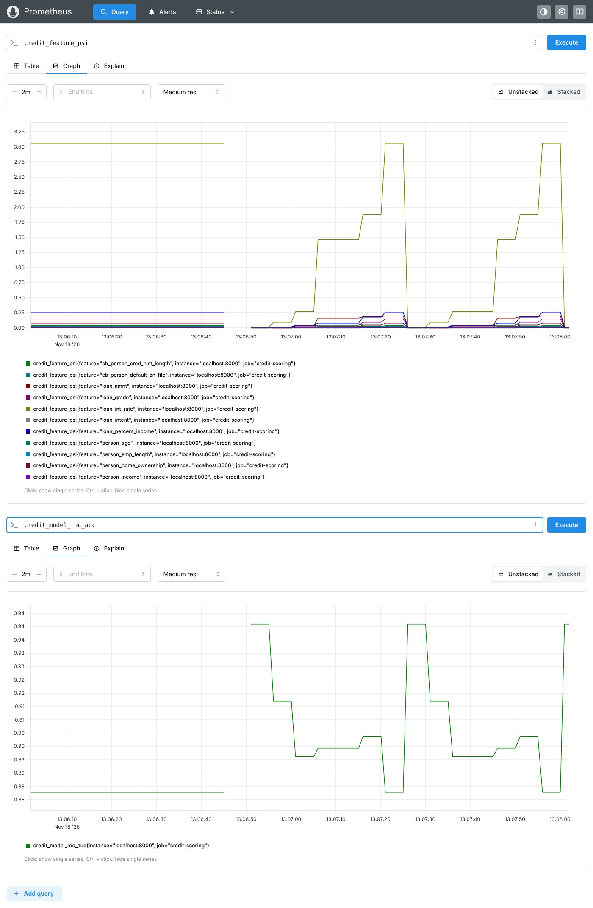
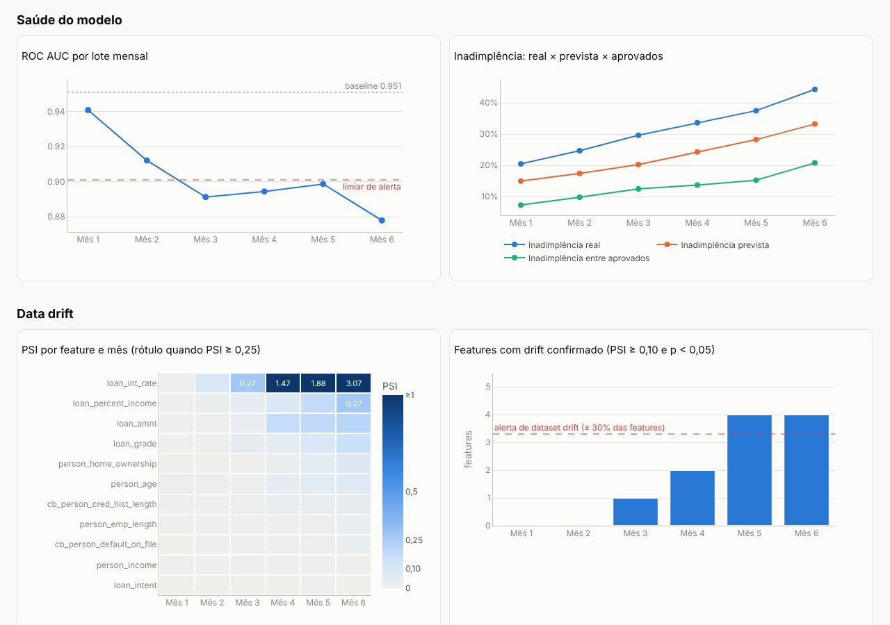
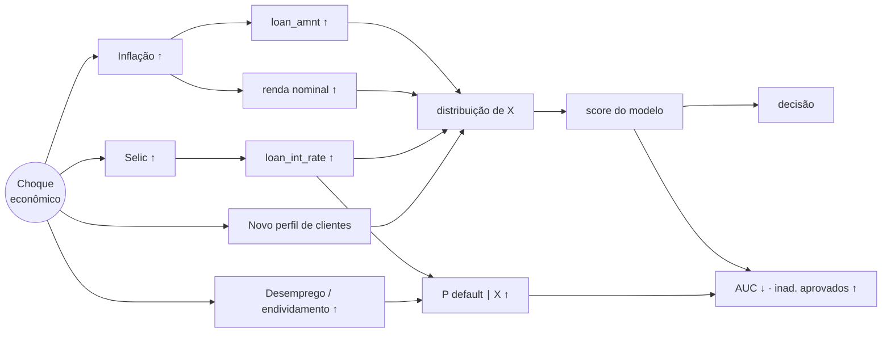

# Tech Challenge — Fase 4 · Observabilidade, Drift, Qualidade de Dados e Governança em Credit Scoring

> **Contexto.** Uma fintech de crédito tem um modelo de *Credit Scoring* em produção. Inflação, alta de juros e novos perfis de clientes levantaram a suspeita de **degradação silenciosa**. Este repositório constrói a camada de **sustentação e confiabilidade** do modelo: contratos de dados que barram lixo na entrada, simulação e detecção de *data drift* e *concept drift*, observabilidade centralizada do pipeline, análise causal da degradação e governança sob a LGPD.

> ### 🌐 [Abrir o site do projeto](https://rochathayna.github.io/tech-challenge-fase4-credit-monitoring/): dashboard, relatórios Evidently e evidências direto no navegador, sem instalar nada

---

## Resultados em uma tela

| | Mês 1 (estável) | Mês 6 (degradado) |
|---|---|---|
| ROC AUC (baseline de validação: **0,951**) | 0,941 | **0,878** (−0,073) |
| Inadimplência **entre clientes aprovados** | 7,3 % | **20,8 %** (≈ 3×) |
| Inadimplência real × prevista | 20,5 % × 14,9 % | 44,3 % × 33,2 % |
| Features com drift confirmado | 0 / 11 | 4 / 11 (`loan_int_rate`, `loan_percent_income`, `loan_amnt`, `loan_grade`) |
| Status do monitoramento | Saudável | **Crítico** · 6 alertas |

- **Contratos de dados:** 3 lotes bloqueados (dado bruto do Kaggle com 4.390 registros inválidos, lote corrompido de parceiro e o 1º envio do mês 4), 7 aceitos.
- **Análise causal:** o *concept drift* (estresse econômico) é o mecanismo que mais derruba a AUC (−0,080) e dobra a inadimplência entre aprovados, mas **não dispara nenhum alerta de data drift**. Já a mudança no perfil de clientes gera ~30 % das features com drift e **não piora** a AUC. Ou seja, monitorar só a distribuição das features não basta.

Evidências geradas automaticamente (versionadas em `reports/` e publicadas no [site](https://rochathayna.github.io/tech-challenge-fase4-credit-monitoring/)):

| Artefato | O que mostra |
|---|---|
| [`reports/monitoring_dashboard.html`](reports/monitoring_dashboard.html) | Dashboard consolidado: saúde do modelo, PSI por feature/mês, contratos, pipeline, latência, alertas, análise causal |
| [`reports/drift/month_XX.html`](reports/drift/) | Relatórios **Evidently AI** por lote (PSI, KS, drift do score e do target, performance de classificação) |
| [`reports/drift/month_XX.json`](reports/drift/) | Resumo estruturado de cada lote (testes, métricas, alertas) |
| [`reports/data_contract_results.json`](reports/data_contract_results.json) | Resultado do contrato e violações por regra |
| [`reports/causal_analysis.json`](reports/causal_analysis.json) | Efeitos causais por mecanismo (20 sementes) |
| [`reports/metrics.prom`](reports/metrics.prom) | Métricas no formato Prometheus (textfile collector) |
| [`logs/pipeline.jsonl`](logs/pipeline.jsonl) | Log estruturado centralizado de todas as etapas |
| [`models/model_card.json`](models/model_card.json) | Model card: métricas, importância de features, fairness por grupo |
| `mlflow.db` / `mlartifacts/` | Rastreamento MLflow (regenerado ao executar) |
| `evidently_workspace/` | Projeto do **Evidently UI** com o histórico mensal (regenerado ao executar) |
| [`monitoring/`](monitoring/) | Stack **Prometheus + Grafana** (docker-compose, 7 regras de alerta, dashboard provisionado) |
| [`docs/img/`](docs/img/) | Capturas das UIs (MLflow, Evidently UI, Prometheus) |

---

## Como executar

```bash
python -m venv .venv && source .venv/bin/activate
pip install -r requirements.txt

make all            # = python -m src.pipeline  (≈ 30 s, executa as 4 etapas ponta a ponta)
make test           # 13 testes (contratos e estatísticas de drift)
make dashboard      # abre reports/monitoring_dashboard.html
make mlflow         # MLflow UI      → http://127.0.0.1:5000
make evidently-ui   # Evidently UI   → http://127.0.0.1:8001  (painel histórico mês a mês)
make grafana        # docker compose → Grafana http://localhost:3000 · Prometheus http://localhost:9090
make site           # gera o site estático (_site/) publicado no GitHub Pages
```

Em produção, a chave de pseudonimização deve vir de um cofre: `export PII_HMAC_KEY=...` (sem ela, usa-se uma chave de desenvolvimento).

## Arquitetura



```
├── data/raw/credit_risk.csv     # dataset público (Kaggle Credit Risk, 26.064 linhas, sem PII)
├── src/
│   ├── config.py                # caminhos, features, limiares de alerta
│   ├── data_prep.py             # ingestão, pseudonimização, limpeza, split Referência/Holdout
│   ├── contracts.py             # contrato de dados Pandera (10 regras)
│   ├── validate.py              # gate de ingestão, quarentena, lote corrompido de demonstração
│   ├── train.py                 # baseline XGBoost + MLflow + model card + fairness
│   ├── simulate_drift.py        # 6 meses de produção com data drift e concept drift
│   ├── drift_stats.py           # PSI, KS e Qui² implementados do zero
│   ├── detect_drift.py          # relatórios Evidently + regras de alerta
│   ├── causal.py                # intervenções do(·) por mecanismo
│   ├── monitoring.py            # MLflow por lote, Prometheus textfile, dashboard HTML
│   ├── evidently_workspace.py   # projeto + painéis do Evidently UI
│   ├── exporter.py              # exporter Prometheus (/metrics) com modo replay
│   ├── build_site.py            # site estático do GitHub Pages
│   ├── logging_utils.py         # logs estruturados JSON Lines
│   └── pipeline.py              # orquestrador ponta a ponta
├── monitoring/                  # docker-compose Prometheus + Grafana, alertas, dashboard
├── tests/                       # pytest
├── .github/workflows/           # CI (testes + pipeline) e deploy do GitHub Pages
├── reports/  logs/  models/     # evidências geradas
└── docs/roteiro_video_STAR.md
```

**Dataset.** [Credit Risk Dataset (Kaggle)](https://www.kaggle.com/datasets/laotse/credit-risk-dataset), split de treino de 26.064 propostas, classificação binária `loan_status` (1 = inadimplente, base rate 21,8 %). Atende ao requisito de ≥ 5.000 amostras.

**Separação Referência × Produção.** Após limpeza, os dados viram **Referência** (60 %, 13.561 linhas, usada no treino e como base de comparação) e **Holdout** (40 %, 9.041 linhas, pool **nunca visto pelo modelo** de onde nascem os 6 lotes mensais de produção com 1.500 propostas cada). O modelo é treinado em 75 % da referência; os 25 % restantes (validação, 3.391 linhas, mesma distribuição) formam a referência pontuada usada pelo Evidently, com predições e rótulos.

---

## Etapa 1 — Validação de dados e contratos

**Ferramenta:** Pandera (`DataFrameSchema`, `strict=True`, `coerce=False`, validação `lazy` para reportar todas as falhas de uma vez).

| Regra | Descrição | Tipo |
|---|---|---|
| R1 | Nenhum nulo em nenhuma coluna | coluna |
| R2 | Idade entre 18 e 100 anos | coluna |
| R3 | Renda > 0 e ≤ R$ 2.000.000 | coluna |
| R4 | Sem duplicatas: `client_id` único **e** nenhum registro de proposta repetido | coluna + linha |
| R5 | Domínios fechados (moradia, finalidade, grade A–G, histórico Y/N, target 0/1) | coluna |
| R6 | Tempo de emprego 0–60 anos **e** coerente com a idade (`emp_length ≤ idade − 14`) | coluna + linha |
| R7 | Valor do empréstimo 500–35.000; juros 0–35 % a.a. | coluna |
| R8 | `loan_percent_income ≈ loan_amnt / person_income` (tolerância 0,02) | linha |
| R9 | **Privacidade:** schema estrito. Coluna não prevista (ex.: `cpf` em claro) é rejeitada | schema |
| R10 | `client_id` precisa ser pseudônimo SHA-256 (64 hex), nunca identificador cru | coluna |

Lote reprovado **não chega ao modelo**: é gravado em `data/quarantine/<lote>.csv` com `<lote>_violations.csv` e gera o evento `batch_blocked` no log. Em produção, o contrato de scoring roda sem o target (`require_target=False`), porque o rótulo só existe ~90 dias depois.

**Evidências (execução real):**

| Lote | Resultado | Violações | Principais regras |
|---|---|---|---|
| `raw_kaggle_ingest` (dado bruto) | ❌ bloqueado | 4.390 | R1 juros nulos (2.498), R6 emprego incoerente com idade (715), R1 tempo de emprego nulo (713), R8 (226), R4 duplicatas (224), R2 idade 123/144 |
| `reference_dataset` (após limpeza) | ✅ aceito | 0 | — |
| `corrupted_partner_batch` (lote sujo injetado) | ❌ bloqueado | 213 | R1, R2 (menores de idade e idade 144), R3 renda negativa, R4, R5 finalidade `CRYPTO`, R6, R7 juros 99 %, R8, **R9 `cpf` vazando** |
| `production_month_04_envio_corrompido` | ❌ bloqueado → reenvio solicitado | 212 | idem |

O contrato encontrou problemas **reais** no dataset público (idades de 123 e 144 anos, 123 anos de emprego, 226 propostas cujo comprometimento de renda não fecha com valor/renda), e não só os erros injetados.

**Baseline (XGBoost, validação):** ROC AUC 0,951 · acurácia 0,941 · precisão 0,974 · recall 0,741 · F1 0,842. Hiperparâmetros, métricas, model card, fairness e o modelo serializado ficam no experimento MLflow `credit-scoring-baseline`.

---

## Etapa 2 — Simulação e detecção de drift

### Mecanismo de degradação (`src/simulate_drift.py`)

Intensidade `t = (mês − 1) / 5`: mês 1 é estável, mês 6 tem a degradação máxima.

| Código | Mecanismo econômico | Tipo | Implementação |
|---|---|---|---|
| D1 | Novo perfil de clientes (mais jovens, de aluguel, mais endividados) | *Data drift* (covariate shift): P(X) muda, P(y\|X) preservada | Reamostragem ponderada de linhas reais |
| D2 | Inflação | *Data drift* nominal | Renda **e** valor do empréstimo +15 %·t |
| D3 | Aperto monetário (Selic) | *Data drift* nominal | Taxa de juros +2,5 p.p.·t |
| C1 | Estresse econômico (desemprego/endividamento) | **Concept drift**: P(y\|X) muda | Bons pagadores com alto comprometimento de renda passam a inadimplir com probabilidade 0,35·t·estresse |

Variáveis alteradas intencionalmente: `person_income`, `loan_amnt`, `loan_int_rate` (e, por consequência, `loan_percent_income`), além do mix de clientes.

### Detecção

- **Evidently AI 0.7** (`DataDriftPreset` com **PSI**, `ValueDrift` com **KS** em cada numérica, drift do score `prediction_proba` e do target, `ClassificationPreset`), um HTML por mês.
- **Implementação própria** (`src/drift_stats.py`) de PSI (decis da referência), KS e Qui², usada como verificação cruzada auditável. *Drift confirmado* = PSI ≥ 0,10 (efeito relevante) **e** p < 0,05 (evidência estatística). Exigir os dois evita alarmes por diferenças estatisticamente significativas mas irrelevantes, comuns com amostras grandes.

### Resultado mês a mês

| Mês | ROC AUC | F1 | Inad. real | Inad. prevista | Inad. aprovados | Taxa de aprovação | PSI do score | Features com drift | Status |
|---|---|---|---|---|---|---|---|---|---|
| 1 | 0,941 | 0,806 | 20,5 % | 14,9 % | 7,3 % | 85,1 % | 0,00 | — | 🟢 |
| 2 | 0,912 | 0,789 | 24,7 % | 17,4 % | 9,8 % | 82,6 % | 0,03 | — | 🟢 |
| 3 | 0,891 | 0,790 | 29,6 % | 20,2 % | 12,4 % | 79,8 % | 0,08 | int_rate | 🔴 |
| 4 | 0,894 | 0,804 | 33,6 % | 24,3 % | 13,6 % | 75,7 % | 0,15 | int_rate, amnt | 🔴 |
| 5 | 0,899 | 0,808 | 37,5 % | 28,2 % | 15,2 % | 71,8 % | 0,28 | int_rate, amnt, pct_income, grade | 🔴 |
| 6 | 0,878 | 0,785 | 44,3 % | 33,2 % | 20,8 % | 66,8 % | 0,55 | int_rate, pct_income, amnt, grade | 🔴 |

**Mês 6, por feature (referência → produção):**

| Feature | PSI | Teste | p-valor | Média ref → atual | Drift |
|---|---|---|---|---|---|
| `loan_int_rate` | **3,07** | KS | 5e-193 | 10,97 → 14,80 | ✅ |
| `loan_percent_income` | **0,27** | KS | 3e-46 | 0,17 → 0,23 | ✅ |
| `loan_amnt` | **0,21** | KS | 3e-52 | 9.465 → 12.841 | ✅ |
| `loan_grade` | **0,16** | Qui² | 3e-32 | — | ✅ |
| `person_home_ownership` | 0,08 | Qui² | 8e-18 | — | só significância |
| `person_age` | 0,07 | KS | 3e-09 | 27,8 → 26,4 | só significância |
| `person_income` | 0,01 | KS | 0,095 | 66.309 → 64.815 | ❌ |

> A renda nominal subiu 15 % (inflação), mas o novo mix de clientes tem renda real menor. Os dois efeitos se anulam na distribuição agregada e o PSI de `person_income` fica em 0,01. Esse é um caso clássico em que **olhar a feature isoladamente engana**: o drift aparece na razão `loan_percent_income`.

---

## Etapa 3 — Observabilidade de pipelines e modelos

**Logs centralizados.** Toda etapa escreve eventos JSON em `logs/pipeline.jsonl` (`run_id`, `stage`, `event`, `status`, duração e campos de negócio). É a fonte única de verdade lida pelo MLflow, Prometheus e dashboard. Eventos: `stage_started/succeeded/failed`, `batch_accepted/blocked`, `batch_scored`, `alert`, `batch_analyzed`, `partner_resend_requested`. **Nenhum dado pessoal é logado**, só nomes de lote, contagens e métricas.

**MLflow.** Experimento `credit-scoring-baseline` (treino, model card, fairness, modelo) e experimento `credit-scoring-production-monitoring` (um run por lote, com 25+ métricas incluindo PSI de cada feature, AUC, latência, alertas e o HTML do Evidently como artefato). `make mlflow` abre a UI para comparar os runs ao longo do tempo.



**Evidently UI.** Cada lote mensal vira um *run* do projeto "Credit Scoring — Produção" no workspace local do Evidently, com painéis de histórico: ROC AUC/recall/F1, fração de features com drift, PSI das features-chave, drift do score e do target, p-valores do KS (`make evidently-ui`).



**Prometheus + Grafana** (`monitoring/`, integração com a Fase 3). `src/exporter.py` expõe em `/metrics` mais de 20 séries: `credit_model_roc_auc`, `credit_bad_rate_approved`, `credit_feature_psi{feature}`, `credit_feature_drift{feature}`, `credit_prediction_psi`, `credit_alerts_active{type,severity}`, `credit_batches_total{result}`, `credit_scoring_latency_ms`, `credit_pipeline_stage_duration_seconds{stage}`, entre outras. No modo `--replay`, o exporter "reproduz" a produção (um mês a cada 15 s) para o Grafana mostrar a degradação ao vivo. O Prometheus avalia **7 regras de alerta** ([`alerts.yml`](monitoring/prometheus/alerts.yml)): `ConceptDrift_AUC`, `DatasetDrift`, `FeatureDrift`, `PredictionDrift`, `Calibration`, `BadRateApprovedHigh`, `DataContractBatchBlocked`. O Grafana já sobe com datasource e o dashboard "Credit Scoring — Observabilidade" provisionados, com acesso anônimo. Também há um snapshot estático em `reports/metrics.prom`.

```bash
cd monitoring && docker compose up     # Grafana http://localhost:3000 · Prometheus http://localhost:9090
```

| Regras de alerta disparando (mês 6) | Séries de PSI e AUC durante o replay |
|---|---|
|  |  |

**Dashboard HTML.** `reports/monitoring_dashboard.html`, autocontido e interativo (Plotly), publicado no GitHub Pages: KPIs, AUC × limiar, inadimplência real × prevista × aprovados, heatmap de PSI, features com drift, violações do contrato, saúde e latência do pipeline, tabela de alertas e análise causal.



### Métricas de saúde definidas

| Camada | Métrica | Fonte | Limiar / alerta |
|---|---|---|---|
| Pipeline | Status de cada etapa (sucesso/falha) | `stage_*` | qualquer `stage_failed` |
| Pipeline | Duração por etapa (s) | `duration_s` | > 3× a mediana histórica |
| Pipeline | Volume por lote (linhas) | `rows` | variação > 30 % vs. média |
| Qualidade | Lotes aceitos / bloqueados, violações por regra | `batch_*` | qualquer bloqueio → reenvio do parceiro |
| Infra | Latência e throughput do scoring | `batch_scored` | latência > 500 ms/lote |
| Drift | PSI por feature | Evidently + próprio | 0,10 atenção · 0,25 drift |
| Drift | Fração de features com drift | idem | ≥ 30 % → `DATASET_DRIFT` (crítico) |
| Drift | PSI do score do modelo | idem | ≥ 0,10 → `PREDICTION_DRIFT` |
| Modelo | ROC AUC (com rótulo) | `ClassificationPreset` | queda ≥ 0,05 vs. baseline → `CONCEPT_DRIFT` (crítico) |
| Modelo | Inad. real − prevista | idem | ≥ 8 p.p. → `CALIBRATION` |
| Negócio | Inadimplência entre aprovados, taxa de aprovação | idem | acompanhamento pela área de risco |

**Alertas emitidos na execução:** 18 (5 `FEATURE_DRIFT`, 4 `CONCEPT_DRIFT`, 4 `CALIBRATION`, 3 `PREDICTION_DRIFT`, 2 `DATASET_DRIFT`), além de 3 bloqueios de lote. O primeiro alerta crítico aparece no **mês 3**, dois meses antes de o *dataset drift* agregado ser detectado (mês 5).

### Runbook de resposta

| Alerta | Ação |
|---|---|
| `batch_blocked` | Lote em quarentena; parceiro notificado com o relatório de violações; o scoring segue com o último lote válido |
| `FEATURE_DRIFT` / `PREDICTION_DRIFT` | Investigação pelo time de dados (mudança de fonte? de política comercial? economia?) |
| `CALIBRATION` | Recalibrar probabilidades / revisar o ponto de corte com a área de risco |
| `CONCEPT_DRIFT` ou `DATASET_DRIFT` crítico | Abrir ciclo de retreino com janela recente; validar o *challenger* contra o *champion* em shadow mode antes de promover; até lá, endurecer política e ampliar revisão humana |

---

## Análise causal da degradação



Correlação no dashboard não explica a degradação: no mês 6 todos os mecanismos atuam juntos. Como o processo gerador é conhecido, aplicamos **intervenções** do tipo `do(·)`, ligando um mecanismo por vez sobre a mesma base, com 20 sementes (Monte Carlo). O efeito causal de cada mecanismo é a diferença em relação ao controle (`src/causal.py`).

| Cenário (mês 6) | ROC AUC | Inad. aprovados | Inad. real | Features c/ drift |
|---|---|---|---|---|
| controle | 0,941 ± 0,007 | 6,9 % | 20,2 % | 0 % |
| do(D1) perfil de clientes | 0,963 ± 0,006 | 8,9 % | 36,5 % | **30 %** |
| do(D2+D3) inflação e juros | 0,906 ± 0,008 | 7,1 % | 20,2 % | 9 % |
| do(C1) estresse econômico | **0,861 ± 0,011** | **13,6 %** | 26,0 % | **0 %** |
| completo (produção) | 0,874 ± 0,007 | 20,7 % | 44,8 % | 36 % |

**Conclusões:**

1. **O concept drift é a causa principal da perda de discriminação** (−0,080 de AUC; a inadimplência entre aprovados dobra) e é **invisível** para os testes de distribuição de features (0 % de drift). Só aparece com rótulos (AUC, calibração), o que reforça a necessidade de acompanhar a performance com *label lag* e de usar proxies antecipados (score drift, rolagem de atraso em 30 dias).
2. **Drift não é sinônimo de degradação.** A mudança de perfil (D1) é o que mais acende alertas de drift, mas *melhora* a AUC (a população fica mais separável) e eleva a inadimplência apenas porque entram mais clientes arriscados. O modelo continua ordenando bem; o problema aí é de **política/ponto de corte**, não de retreino.
3. **Inflação e juros (D2+D3)** reduzem a AUC (−0,035) porque o modelo interpreta renda e juros em valores nominais do passado. Remédio: features deflacionadas/relativas (ex.: renda em salários mínimos, spread sobre a Selic).
4. **Os efeitos interagem**: o cenário completo eleva a inadimplência entre aprovados em 13,8 p.p., mais que a soma dos efeitos isolados (≈ 8,9 p.p.). Mais clientes de alto comprometimento (D1) ficam expostos ao estresse (C1).

---

## Etapa 4 — Governança e LGPD

### Inventário e tratamento dos dados pessoais

| Dado | Classificação LGPD | Tratamento neste projeto |
|---|---|---|
| CPF | Dado pessoal identificador | Simulado na ingestão (sintético) e **substituído imediatamente** por pseudônimo HMAC-SHA256 com chave secreta (`PII_HMAC_KEY`, em cofre). O CPF é descartado e nunca é persistido, logado ou usado no treino |
| Idade, renda, moradia, tempo de emprego | Dado pessoal (não sensível) | Usados como features. Necessários para a finalidade (capacidade de pagamento) |
| Histórico de crédito (default, tempo de histórico) | Dado pessoal de adimplemento (Lei 12.414/2011, Cadastro Positivo) | Usados como features, com base legal própria |
| Sexo, raça/cor, religião, saúde, biometria, orientação sexual | **Sensíveis (art. 5º, II)** | **Não coletados e não usados** (minimização, art. 6º, III) |

**Privacy by Design (art. 46, §2º) aplicado no código:**
- **Pseudonimização na borda** (`data_prep.apply_privacy_by_design`): o identificador direto não atravessa a fronteira de ingestão.
- **Contrato como controle de privacidade**: as regras R9 (schema estrito rejeita `cpf`/`nome` em claro) e R10 (`client_id` precisa ser hash) **bloqueiam** qualquer vazamento de PII, que é tratado como falha de qualidade.
- **Minimização:** só as 11 features necessárias entram no modelo; a lista é fechada no contrato.
- **Logs e relatórios sem PII:** logs registram contagens e métricas; relatórios Evidently mostram apenas distribuições agregadas.

**Privacy by Default:** acesso aos dados de treino restrito ao time de modelagem (*least privilege*); lotes em quarentena com retenção curta; artefatos (`mlflow.db`, dados processados) fora do Git (`.gitignore`).

### Base legal da decisão de crédito

- **Art. 7º, X: proteção do crédito.** Base principal para tratar dados de análise de risco, inclusive consulta a bureaus e histórico de adimplemento (Lei 12.414/2011).
- **Art. 7º, V: procedimentos preliminares relacionados a contrato** a pedido do titular (a proposta de empréstimo).
- **Não** usamos consentimento como base: ele seria revogável a qualquer momento, o que é incompatível com a obrigação de gestão de risco de crédito (Res. CMN 4.557/2017).
- **Art. 20: decisões automatizadas.** O titular pode solicitar **revisão** da decisão e **informações claras sobre os critérios** usados. Implementação: o modelo é **apoio à decisão** com revisão humana garantida para negativas contestadas; o model card registra features e importâncias; cada decisão pode ser explicada pelas contribuições das variáveis (ex.: SHAP sobre o XGBoost) sem expor o segredo do modelo.
- **Art. 18: direitos do titular** (acesso, correção, anonimização, portabilidade, informação sobre compartilhamento). O pseudônimo permite localizar os registros de um titular **somente** por quem detém a chave, mediante requisição formal ao DPO.

### Plano de retenção

| Dado | Retenção | Justificativa | Descarte |
|---|---|---|---|
| CPF em claro | **0**, descartado na ingestão | Minimização | Não persiste |
| Chave HMAC | Enquanto houver dados pseudonimizados ativos | Reidentificação controlada para direitos do titular | Rotação anual; destruir a chave anonimiza efetivamente o histórico |
| Propostas e decisões (pseudonimizadas) | 5 anos após o encerramento do contrato | Prazo prescricional (CDC art. 27 / CC art. 206) e auditoria regulatória do BACEN | Exclusão ou anonimização irreversível (agregação) |
| Dataset de treino / referência | Vida útil do modelo + 5 anos | Reprodutibilidade e auditoria do modelo | Anonimização |
| Lotes em quarentena | 30 dias | Diagnóstico com o parceiro | Exclusão automática |
| Logs operacionais (sem PII) | 1 ano | Observabilidade e auditoria do pipeline | Rotação |
| Relatórios de drift / MLflow (agregados) | Indeterminado | Não contêm dados pessoais | — |

### Mitigação de vieses

Atributos sensíveis não são usados, mas **proxies** podem reintroduzir discriminação. O treino gera, no model card, métricas por grupo na validação:

| Grupo | n | Aprovação | Inad. real | AUC | Aprovação de bons pagadores | Impacto desigual (regra 4/5) |
|---|---|---|---|---|---|---|
| 18–25 anos | 1.588 | 82,2 % | 23,0 % | 0,964 | 99,5 % | 0,96 |
| 26–35 anos | 1.443 | 85,7 % | 19,3 % | 0,942 | 99,6 % | 1,00 |
| 36+ anos | 360 | 85,3 % | 19,7 % | 0,930 | 99,0 % | 1,00 |
| Aluguel (RENT) | 1.750 | 75,0 % | 30,0 % | 0,963 | 99,3 % | **0,80** ⚠️ |
| Financiado (MORTGAGE) | 1.362 | 93,9 % | 12,0 % | 0,890 | 99,5 % | 1,00 |
| Próprio (OWN) | 270 | 92,2 % | 8,5 % | 1,000 | 100 % | 0,98 |

- **Idade:** sem impacto desigual relevante (todos ≥ 0,96). A idade é usada por relação legítima com o risco e só a partir de 18 anos (contrato, R2).
- **Moradia** está no limite da regra dos 4/5 (0,80). A diferença de aprovação acompanha a diferença real de risco (30 % × 12 %), e a **igualdade de oportunidade** é atendida: um bom pagador é aprovado ~99 % das vezes em qualquer grupo. Ainda assim, moradia é proxy socioeconômico, por isso fica **sob monitoramento contínuo** e pode passar por revisão de política.
- O drift agrava o risco de viés: o novo perfil (D1) concentra jovens e locatários, justamente os grupos mais expostos. Por isso as métricas por grupo devem ser recalculadas a cada retreino.
- Governança complementar: RIPD (art. 38) antes de cada nova versão do modelo, comitê de modelos (risco + jurídico + DPO) para aprovar promoções, e trilha de auditoria (MLflow + model card + logs).

---

## Lições aprendidas

1. **Contrato de dados é a primeira linha de defesa** e encontrou erros reais no dataset público que teriam ido direto para o treino.
2. **Data drift ≠ degradação**, e **degradação pode ocorrer sem data drift**. Monitorar só features gera falsos alarmes e deixa passar o pior problema; é preciso combinar drift de features, drift do score, calibração e performance com rótulo.
3. **Métricas de negócio contam a história melhor que AUC**: a AUC caiu 0,07, mas a inadimplência entre aprovados quase triplicou (7,3 % → 20,8 %).
4. **Efeitos podem se cancelar** (renda nominal × renda real): monitore razões e features derivadas, não só variáveis brutas.
5. **Exigir efeito + significância** (PSI e p-valor) reduz alarmes espúrios em amostras grandes.
6. **Privacidade como regra de qualidade**: tratar vazamento de PII como violação de contrato torna a LGPD verificável e automatizada.

## Limitações e próximos passos

- O drift é **simulado**. Em produção, a janela de rótulos (~90 dias) atrasa a detecção do concept drift; usar proxies como rolagem em 30 dias (*early default*).
- Orquestração local; em produção o pipeline iria para Airflow/Prefect, com o Alertmanager do Prometheus roteando os alertas para Slack/PagerDuty.
- Próximos passos: retreino automático com janela deslizante, explicações SHAP por decisão (art. 20) e features deflacionadas.
